# ApexBet — Real-Time Data Platform

A runnable, end-to-end data engineering platform for a *fictional* sportsbook and
casino operator. It covers streaming ingestion, a medallion data lake, analytics,
data quality, financial reconciliation, anomaly detection, optional record
enrichment, orchestration, observability, and an interactive React dashboard — all
on one machine.

It runs locally with **no AWS account, no paid service, and no external AI API
key**, using **synthetic data only**. It never connects to a real betting
platform, account, or payment provider.

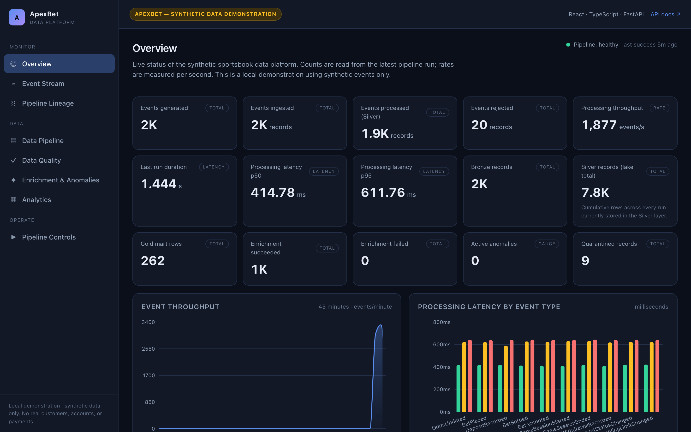

---

## Contents

1. [Overview](#overview)
2. [Key capabilities](#key-capabilities)
3. [System architecture](#system-architecture)
4. [Data pipeline (medallion layers)](#data-pipeline-medallion-layers)
5. [Event processing lifecycle](#event-processing-lifecycle)
6. [Technology stack](#technology-stack)
7. [Dashboard walkthrough](#dashboard-walkthrough)
8. [Repository structure](#repository-structure)
9. [Getting started](#getting-started)
10. [Running the application](#running-the-application)
11. [API reference](#api-reference)
12. [Testing and code quality](#testing-and-code-quality)
13. [Performance benchmarks](#performance-benchmarks)
14. [Infrastructure and CI](#infrastructure-and-ci)
15. [Known limitations](#known-limitations)
16. [Future improvements](#future-improvements)
17. [License](#license)

---

## Overview

A sportsbook is a difficult place to run data: events arrive continuously, every
monetary value has to reconcile to the exact minor unit, and bad records have to
be quarantined without stalling the stream.

ApexBet models that problem end-to-end using real open-source components. A
synthetic generator produces sportsbook and casino events; a FastAPI service
ingests them; a consumer pipeline validates, deduplicates, and writes them
through raw, cleaned, and analytics-ready storage layers; a DuckDB warehouse
builds the analytical marts; and separate services run data-quality checks,
financial reconciliation, and anomaly detection over the result. A React
dashboard reads from the same backend API the pipeline writes to.

Everything is designed to be demonstrated live: start the stack, generate
traffic from the Pipeline Controls page, and watch a single event travel from the
generator through to the dashboard while the quality, reconciliation, and anomaly
views update.

## Key capabilities

- **Streaming ingestion** — a FastAPI service with token auth, rate limiting,
  request-size limits, and Prometheus metrics.
- **Two interchangeable transports** — Redpanda (Kafka API) and Kinesis via
  LocalStack, behind one interface, plus an in-process memory transport for
  offline runs and tests. An unknown transport fails fast; there is no silent
  fallback.
- **Reliable processing** — deduplication window, retries with backoff and
  jitter, a dead-letter queue, watermark handling for late events, and
  checkpointing.
- **Medallion lake** — raw (Bronze), cleaned (Silver), and analytics-ready (Gold)
  layers stored as partitioned Parquet, on a filesystem or S3-compatible store
  behind one storage interface.
- **Analytics** — nine Gold marts built with DuckDB (SQL), covering betting
  activity, outcomes, financials, casino activity, completeness, and latency.
- **Data quality** — eleven deterministic rules over cleaned records, with
  results persisted for querying.
- **Financial reconciliation** — nine source-to-target rules comparing totals in
  exact minor units.
- **Anomaly detection** — statistical threshold and z-score rules over pipeline
  metrics, plus an optional scikit-learn Isolation Forest baseline, with a
  reproducible evaluation harness.
- **Optional enrichment** — rules-based by default; a scikit-learn model and a
  local LLM are optional and degrade gracefully.
- **Interactive dashboard** — eight pages, all reading from the real API.
- **Orchestration, observability, and IaC** — four Airflow DAGs, Prometheus and
  Grafana configuration, and Terraform modules (validate-only).

Money is stored as **integer minor units** everywhere; `Decimal` is used only at
boundaries. This avoids floating-point rounding errors in financial totals.

## System architecture

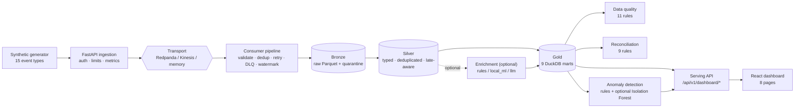

The generator and ingestion service write to a transport. A consumer pipeline
reads from it, validates each event, and writes raw records to Bronze and cleaned
records to Silver. The DuckDB engine loads Silver, builds the Gold marts, and the
quality, reconciliation, and anomaly services run over the result. The serving
API is a read-only layer on top of these artefacts; the dashboard consumes it.

Fuller detail, including component boundaries, is in
[`docs/architecture/README.md`](docs/architecture/README.md).

## Data pipeline (medallion layers)

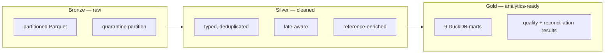

| Layer | Responsibility | Storage |
|-------|----------------|---------|
| **Bronze** | Events exactly as consumed, plus a quarantine partition for boundary failures | `lake/bronze/event_type=…/event_date=…/*.parquet` |
| **Silver** | Typed, deduplicated, late-aware, reference-enriched records | `lake/silver/…` |
| **Gold** | Nine analytical marts plus quality, reconciliation, and anomaly results | `lake/gold/…` and DuckDB |

Transformations between layers are ordinary Python modules
(`src/apexbet/bronze/`, `src/apexbet/silver/`), and the Gold marts are SQL in
`sql/dbt/`. The dbt project is compiled and executed against local DuckDB by
`apexbet validate-dbt`, so no dbt runtime is required.

## Event processing lifecycle

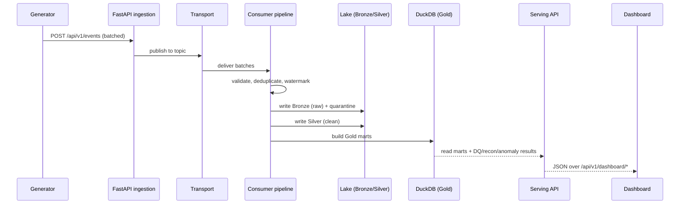

## Technology stack

| Layer | Technology |
|-------|------------|
| Streaming | Redpanda (Kafka API) · AWS Kinesis via LocalStack · in-process memory transport |
| Ingestion | FastAPI · Pydantic v2 · Uvicorn |
| Storage | Partitioned Parquet · one `ObjectStore` interface (local filesystem / S3-compatible) |
| Transformation | Python pipeline modules · dbt project (SQL-first, validated offline) |
| Analytics | DuckDB (9 Gold marts) |
| Orchestration | Apache Airflow (4 DAGs) · optional PySpark / Iceberg |
| Quality | 11 deterministic data-quality rules · 9 reconciliation rules |
| Enrichment | Rules (default) · scikit-learn · local Ollama LLM (optional) |
| Observability | Prometheus · Grafana · structured JSON logs |
| Dashboard | React · TypeScript · Vite · Recharts · React Flow · TanStack Query |
| Infrastructure | Terraform (7 modules / 24 resources — validate only) · Docker Compose |
| CI | GitHub Actions (quality, tests, offline e2e, frontend, Playwright, Docker, Terraform, secret scan) |

## Dashboard walkthrough

The dashboard reads from the serving API only. Each page below is a real capture
of the running application against synthetic data.

**Overview** — pipeline KPIs from the latest run, with totals and rates labelled
separately.


**Event Stream** — events per minute as they move through the pipeline, with a
recent-activity table. The pause control stops the UI refresh only; the pipeline
is not affected.

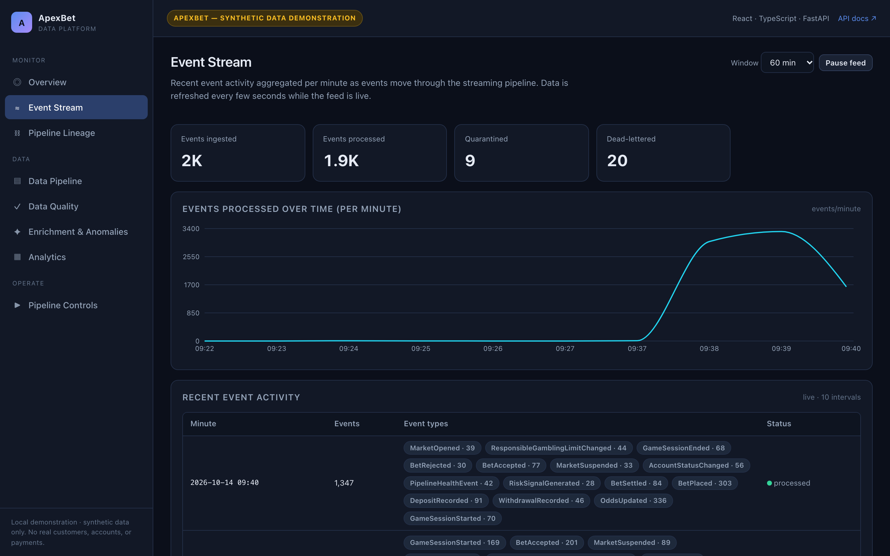

**Pipeline Lineage** — the path data follows through the system. Node status
reflects current pipeline state, and edges animate only while recent data is
flowing. Clicking a node opens a details panel with input/output counts and the
relevant API endpoint.

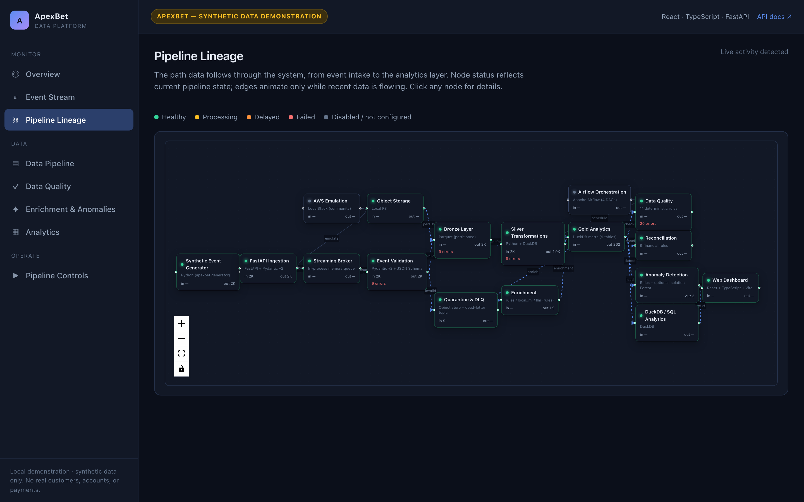

**Data Pipeline** — object counts, sizes, and freshness for the Bronze, Silver,
and Gold layers, plus a paginated dataset browser over the stored data.

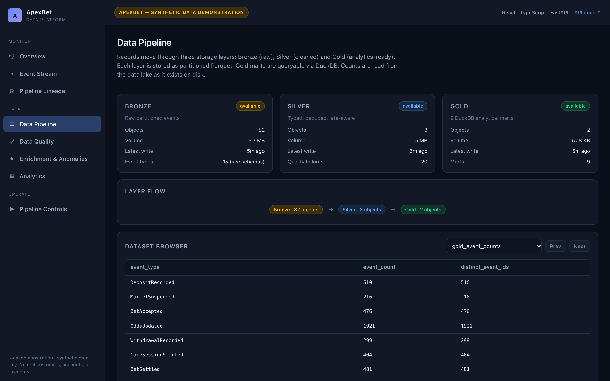

**Data Quality** — the eleven validation rules and their outcomes, alongside the
nine reconciliation findings, searchable and filterable.

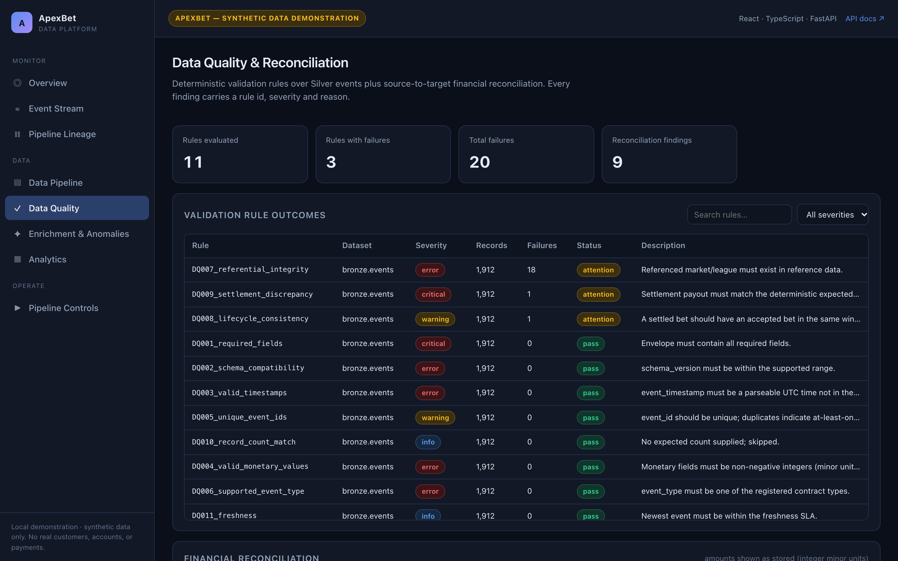

**Enrichment & Anomalies** — enrichment records and their processing status,
plus anomaly alerts with severity, metric, observed versus expected values, and
an explanation.

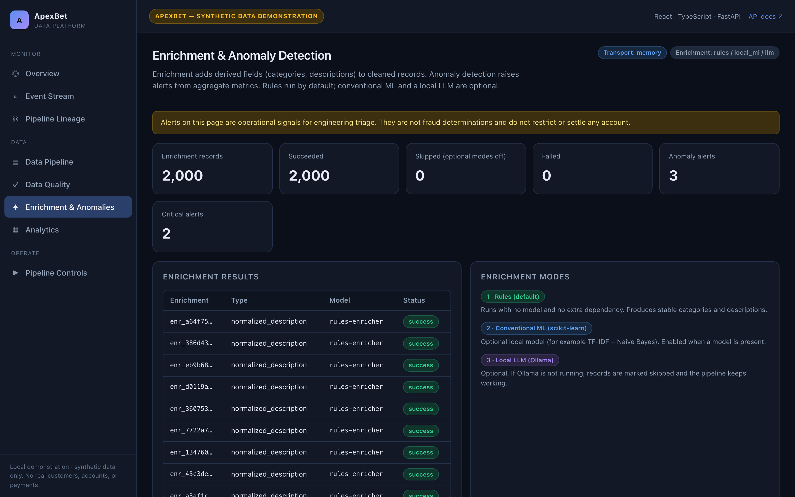

**Analytics** — charts and tables built directly from the Gold marts (event
volume, event-type distribution, settlement outcomes, latency).

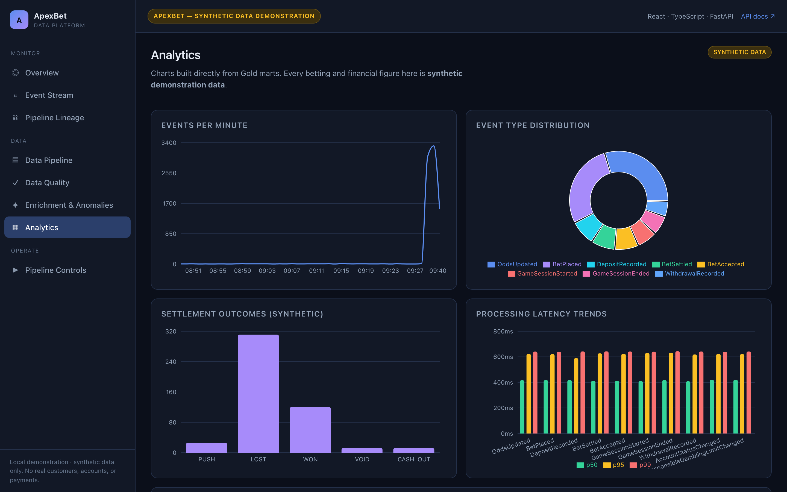

**Pipeline Controls** — bounded, validated buttons that run real backend jobs
(use the smallest preset for a quick demo). Jobs are capped at 50,000 events and
execute server-side; there is no shell access.

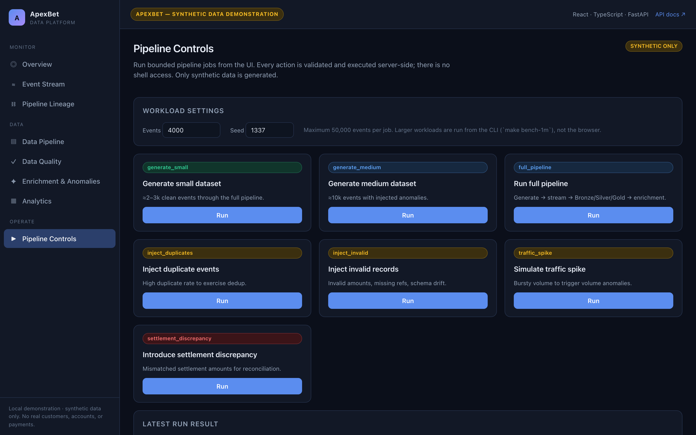

## Repository structure

```
.
├── src/apexbet/            # backend package
│   ├── generator/          # synthetic event generator
│   ├── ingestion/          # FastAPI ingestion service
│   ├── streaming/          # transports (redpanda, kinesis, memory) + consumer
│   ├── lake/               # Bronze / Silver writers
│   ├── enrichment/         # rules / local_ml / llm enrichment
│   ├── analytics/          # DuckDB engine + Gold marts
│   ├── quality/            # 11 data-quality rules
│   ├── reconciliation/     # 9 financial reconciliation rules
│   ├── anomaly/            # rule + Isolation Forest detectors
│   ├── serving/            # dashboard read API + typed models
│   ├── demo_control.py     # bounded, validated demo jobs
│   └── cli/                # the `apexbet` CLI
├── frontend/               # React + TypeScript dashboard
│   ├── src/components/     # charts + UI primitives
│   ├── src/pages/          # the 8 dashboard pages
│   ├── src/hooks/          # typed data hooks
│   ├── src/services/       # API client + formatting
│   ├── src/types/          # typed backend contracts
│   └── e2e/                # Playwright smoke tests
├── dags/                   # 4 Airflow DAGs
├── sql/dbt/                # dbt project (10 models)
├── infra/terraform/        # 7 modules / 24 resources (validate only)
├── docker/                 # Dockerfile + service configs
├── docs/                   # architecture, data-engineering, enrichment, ops, testing
├── tests/                  # unit · contract · reliability · integration
├── docker-compose.yml      # 'demo' + 'full' profiles
└── Makefile                # all entry points
```

More detail is in [`docs/`](docs/README.md). Each backend subsystem has its own
README alongside the code.

## Getting started

**Prerequisites:** Python 3.11, [`uv`](https://github.com/astral-sh/uv) (or a
plain virtualenv), and Node.js 18+ for the dashboard. Docker Desktop is optional
and only needed for the broker/AWS-emulation paths.

```bash
# Backend
make setup                 # create .venv and install the project with dev extras

# Dashboard
make frontend-install      # install npm dependencies
```

No credentials are required. `.env.example` documents every setting; all defaults
are offline-safe. The two most useful switches are:

```bash
APEXBET_TRANSPORT=memory   # memory | redpanda | kinesis  (an unknown value fails fast)
APEXBET_LOG_JSON=false     # human-readable logs for local use
```

## Running the application

Three terminals. The backend and dashboard run at the same time.

```bash
# terminal 1 — generate a dataset and run the full pipeline
make demo                  # offline end-to-end run; prints "DEMO PASSED"

# terminal 2 — backend API
make serve                 # FastAPI on http://127.0.0.1:8000

# terminal 3 — dashboard
make frontend              # Vite dev server on http://localhost:5173
```

Open **http://localhost:5173**. The Overview page reads the run `make demo`
produced; the Pipeline Controls page can generate more data from the browser.

To run with the real broker instead of the in-process transport:

```bash
make up                    # 'demo' profile: Redpanda + API + consumer
make run                   # generate → stream → Bronze/Silver/Gold → quality → reconcile
make frontend
```

See [`docs/operations/README.md`](docs/operations/README.md) for the full set of
targets and the `full` Docker profile (LocalStack, Airflow, Prometheus, Grafana).

## API reference

The backend exposes two groups of endpoints: ingestion (writes) and dashboard
(reads). The dashboard API is versioned under `/api/v1/dashboard` and is
paginated and bounded.

### Ingestion

| Method | Path | Purpose |
|--------|------|---------|
| `POST` | `/api/v1/events` | Ingest a batch of events (token-auth when tokens are configured) |
| `GET` | `/health` · `/ready` | Liveness and readiness |
| `GET` | `/metrics` | Prometheus metrics |

### Dashboard (read)

| Method | Path | Notes |
|--------|------|-------|
| `GET` | `/api/v1/dashboard/health` | Pipeline status, transport, storage, layer stats |
| `GET` | `/api/v1/dashboard/overview` | KPI snapshot from the latest run |
| `GET` | `/api/v1/dashboard/throughput?minutes=` | Events per minute (1–1440) |
| `GET` | `/api/v1/dashboard/latency` | p50/p95/p99 by event type |
| `GET` | `/api/v1/dashboard/layers` | Bronze/Silver/Gold object statistics |
| `GET` | `/api/v1/dashboard/datasets` | List queryable datasets |
| `GET` | `/api/v1/dashboard/preview?dataset=&offset=&limit=` | Paginated rows (limit ≤ 200) |
| `GET` | `/api/v1/dashboard/quality` | Data-quality rule outcomes |
| `GET` | `/api/v1/dashboard/reconciliation` | Reconciliation findings |
| `GET` | `/api/v1/dashboard/enrichment?offset=&limit=` | Enrichment records (paginated) |
| `GET` | `/api/v1/dashboard/enrichment/summary` | Whole-dataset enrichment status counts |
| `GET` | `/api/v1/dashboard/anomalies` | Anomaly alerts |
| `GET` | `/api/v1/dashboard/lineage` | Pipeline graph (nodes + edges) |
| `GET` | `/api/v1/dashboard/nodes/{id}` | A single pipeline node |
| `POST` | `/api/v1/dashboard/demo/{kind}` | Start a bounded job (kind ∈ the preset list, count clamped to 50,000) |
| `GET` | `/api/v1/dashboard/demo/job/{id}` | Job status, log, and result |
| `GET` | `/api/v1/dashboard/demo/latest` | Most recent job |

Example request and response:

```bash
curl 'http://127.0.0.1:8000/api/v1/dashboard/preview?dataset=gold_event_counts&limit=3'
```

```json
{
  "dataset": "gold_event_counts",
  "columns": ["event_type", "event_count", "distinct_event_ids"],
  "rows": [
    {"event_type": "OddsUpdated", "event_count": 1921, "distinct_event_ids": 1921},
    {"event_type": "BetPlaced", "event_count": 1794, "distinct_event_ids": 1794},
    {"event_type": "DepositRecorded", "event_count": 510, "distinct_event_ids": 510}
  ],
  "total": 15,
  "offset": 0,
  "limit": 3,
  "available": true,
  "detail": null
}
```

When an artefact is missing, endpoints return `"available": false` with a `detail`
explanation rather than a placeholder value.

## Testing and code quality

The backend has four test tiers, and infrastructure-dependent tests self-skip
when Docker services are not running.

```bash
make test              # full suite
make test-unit         # fast, no infrastructure
make test-contract     # transport + event contract tests
make test-reliability  # restart, replay, DLQ, and retry behaviour
make test-integration  # needs Docker services; skips if absent
make coverage          # coverage report
make lint              # ruff lint + format check
make typecheck         # mypy
make validate-dbt      # compile + run every dbt model against local DuckDB
make check             # lint + typecheck + tests
```

Dashboard checks:

```bash
make frontend-lint
make frontend-typecheck
make frontend-test     # vitest unit/component tests
make frontend-build    # production build
make frontend-e2e      # Playwright (needs `make serve` and `make frontend` running)
make check-all         # backend + dashboard gates together
```

Measured on a clean checkout (see [`docs/PROGRESS.md`](docs/PROGRESS.md) for the
full record):

| Gate | Result |
|------|--------|
| Backend tests (`pytest`) | 214 tests, 0 failures, 22 skipped |
| Backend coverage | 82% |
| Lint / types | `ruff check` + `ruff format --check` clean · `mypy` clean |
| Frontend tests (`vitest`) | 18 passed |
| Frontend lint / types / build | clean |
| End-to-end (`Playwright`) | 9 passed against the live API |
| dbt models | 10 compile + run offline (`apexbet validate-dbt`) |
| Terraform | HCL validates (7 modules / 24 resources); validate-only |

Skipped tests require Docker services (Redpanda, LocalStack) and self-skip rather
than pass silently.

## Performance benchmarks

The repository includes a benchmark harness (`src/apexbet/benchmark.py`) that
measures generation, publish, and pipeline throughput. Results for a single
machine are recorded in [`docs/testing/benchmarks.md`](docs/testing/benchmarks.md),
including the hardware, workload, and methodology.

```bash
make bench             # 100k events (memory transport)
make bench-1m          # 1M events — slow, writes benchmark_results_1m.json
make bench-broker      # requires `make up`
```

The published numbers are for a single local process and are indicative only.
They are not a claim about production throughput. The 1M-event run is marked
pending in the benchmarks document until a verified result is recorded.

## Infrastructure and CI

GitHub Actions runs the following jobs on every push and pull request:

| Job | What it does |
|-----|--------------|
| `quality` | Ruff lint, Ruff format check, mypy |
| `test` | Unit, contract, and reliability tests with coverage |
| `e2e` | Offline acceptance demo (`apexbet demo`) |
| `frontend` | Dashboard lint, type-check, unit tests, production build |
| `e2e-dashboard` | Playwright end-to-end tests against a live API + dev server |
| `docker` | Compose validation (both profiles) and image build |
| `terraform` | Terraform fmt + validate |
| `security` | Dependency audit and secret scan |

Infrastructure is described in
[`docs/infrastructure/README.md`](docs/infrastructure/README.md). Terraform is
**validate-only** in this repository and is never applied. LocalStack emulates
AWS APIs for the Kinesis and S3 paths; it does not reproduce production AWS
behaviour, quotas, or cost.

## Known limitations

- **Single-node pipeline.** The consumer runs in one process, so throughput is
  CPU-bound. Partitioned, parallel consumers are future work.
- **LocalStack is not production AWS.** It exercises the API surface and
  configuration shape only.
- **Terraform is validate-only.** It has not been applied to a real account.
- **Airflow, Spark, Grafana, and Ollama** run only in the `full` Docker profile.
- **The 1M-event benchmark** is slow on a laptop and is marked pending until a
  verified result is recorded.
- **Iceberg** is optional; the Parquet path is complete without it.
- **Enrichment** via a local LLM validates output structurally but not for factual
  correctness; treat its fields as provisional.
- **Processing latency** is measured as the gap between an event's ingestion
  timestamp and the time Silver processing recorded it. Because the generator
  stamps events across a simulated timeline, these values reflect synthetic event
  age as well as real processing time, so they are not a real-time latency SLO.
- The dashboard is a **local demonstration**, not a deployed product.

## Future improvements

- Parallel, partitioned consumers with a shared dedup store.
- Incremental Gold marts instead of full rebuilds.
- A verified 1M-event benchmark on pinned hardware.
- A hosted demo with a read-only dataset snapshot.

## License

Released under the [MIT License](LICENSE). The platform is a synthetic
demonstration and is not affiliated with any real operator.
