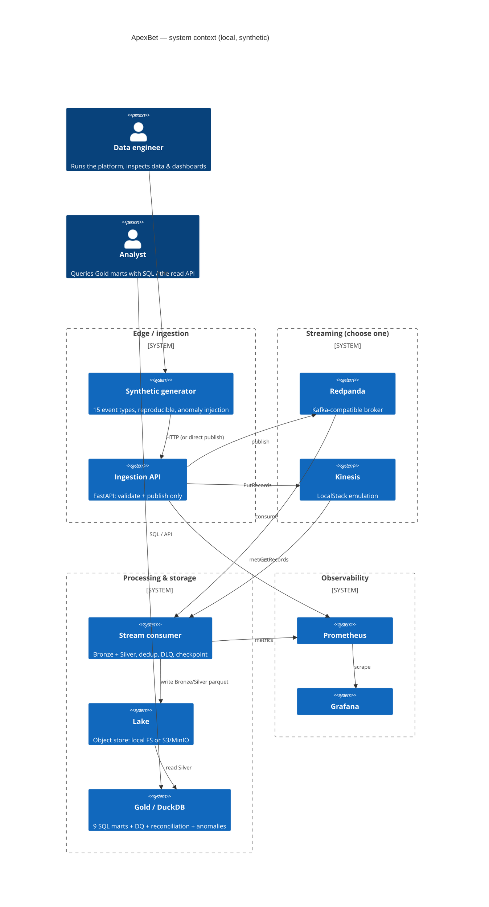
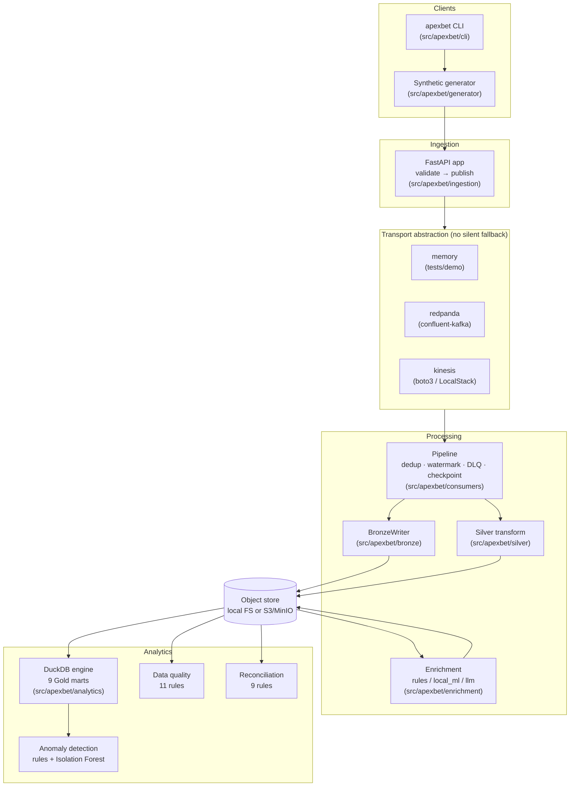
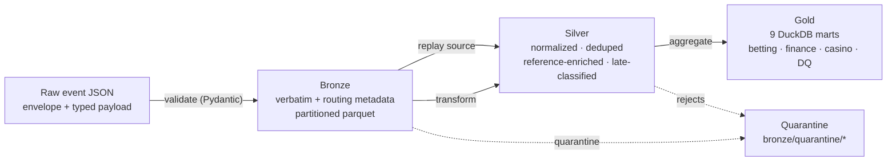
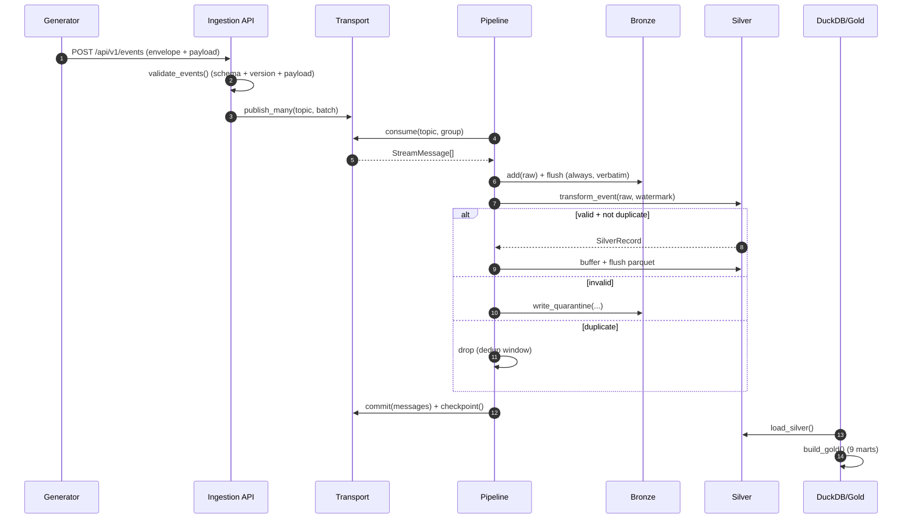
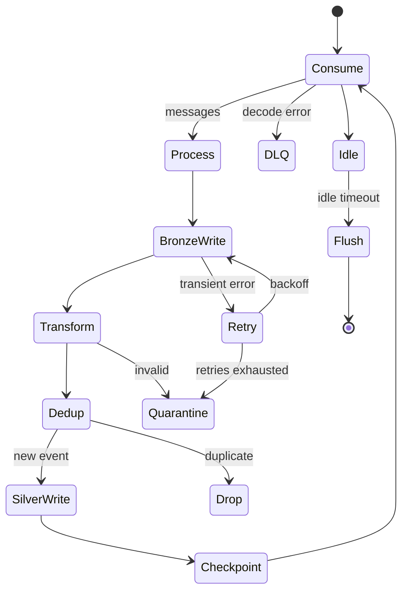
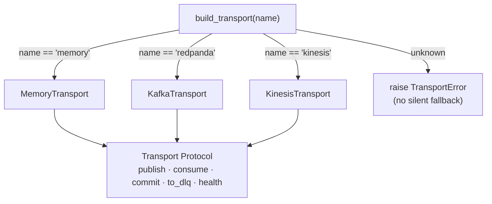
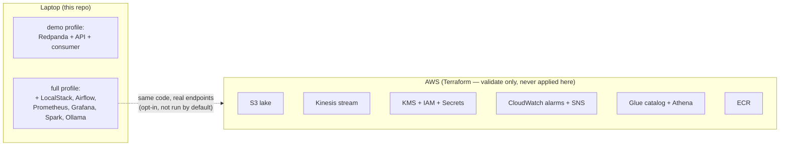
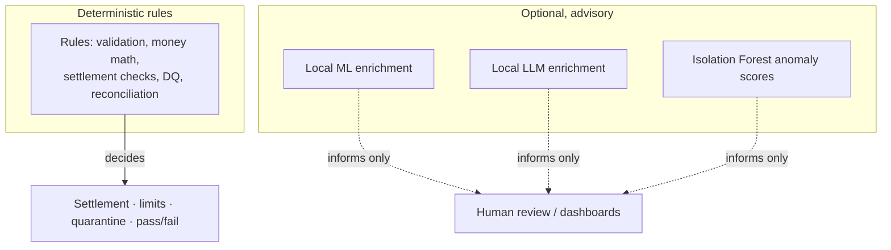
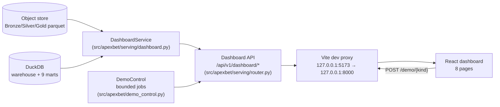
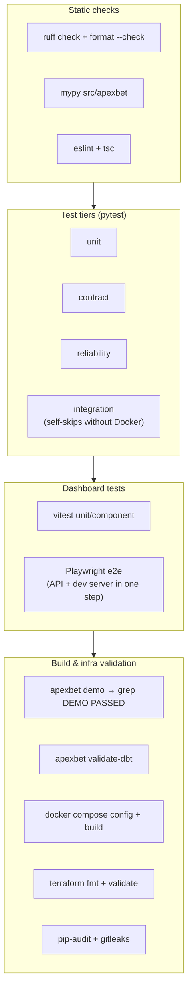

# Architecture

> ApexBet is a **local, AWS-simulated, real-time gambling data platform** built on
> real open-source technology, using **synthetic data only**. It is designed to be
> run end-to-end on a single laptop with **no AWS account, no paid service, and no
> external AI API key**. Every diagram below reflects the code in `src/apexbet`.

## 1. System context

## 2. Container / component view

## 3. Medallion data flow

Every event is **always** written to Bronze verbatim (audit + replay), even if it
is later quarantined. Silver is the single canonical clean dataset; Gold is derived
and rebuildable from Silver at any time.

## 4. Processing sequence (one event)

## 5. Reliability model

* **At-least-once** delivery from both brokers; **exactly-once business effect**
  is achieved downstream by `event_id` dedup + idempotent writes.
* **Bounded retries** with full-jitter exponential backoff (`common.retry`).
* **Dead-letter** routing for structurally broken records (bad JSON).
* **Quarantine** (a lake prefix) for records that fail validation but are
  well-formed JSON — kept for inspection and replay.
* **Checkpointing** persists the committed cursor to the lake after each flush, so
  a restart resumes without reprocessing.

## 6. Two transports, one contract

| Aspect | Redpanda (Kafka) | Kinesis (LocalStack / AWS) |
|---|---|---|
| Delivery | at-least-once | at-least-once |
| Ordering | per partition (key = `account_id`) | per shard (PartitionKey) |
| Commit | explicit offset commit | **no** broker-side commit; sequence no. per shard |
| Replay | seek/consumer-group reset | `AT_TIMESTAMP` / `TRIM_HORIZON` within retention |
| Retention | topic config | 24h default (configurable) |
| DLQ | sibling topic | sibling stream (no native DLQ) |

The transport is chosen by `APEXBET_TRANSPORT`. An unknown value **fails fast**.

## 7. Deployment topologies

The Terraform under `infra/terraform` describes an *optional* AWS deployment. It is
**validated only** (`terraform fmt/validate` locally, or the HCL2 fallback when the
binary is unavailable) and is **never applied automatically**.

## 8. Trust boundaries & non-goals

* Settlement and account restrictions are decided by rules only.
* This is **synthetic data only**; there is no connection to any real betting,
  payment or customer system, and no real money.
* LocalStack community edition is targeted; paid-plan-only features are documented,
  not silently depended upon.

## 9. Serving and dashboard

The dashboard is a read-only client. It never writes pipeline state; the only
write path from the browser is the bounded Pipeline Controls API, which runs
predefined jobs server-side.

Every read endpoint returns `available: false` with a `detail` message when an
artefact is missing, so the UI shows an empty state rather than a fabricated
number. Demo-control jobs are clamped to `MAX_EVENTS` (50,000) and validated
server-side; there is no shell or arbitrary-code path.

## 10. CI and testing architecture

All jobs run in `.github/workflows/ci.yml`. Docker-dependent tests self-skip
rather than pass silently when services are absent.
