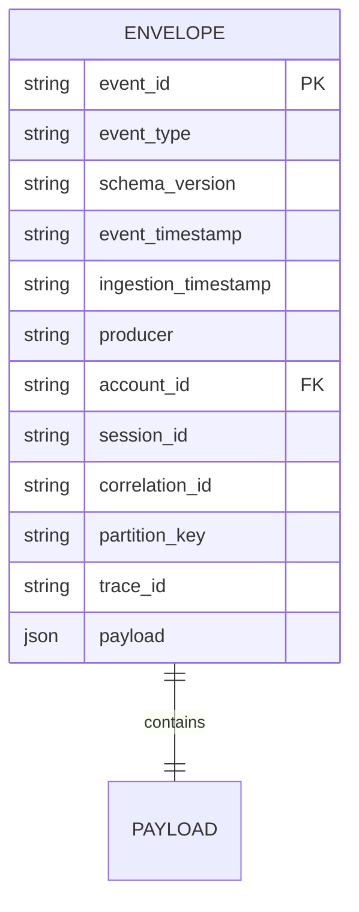
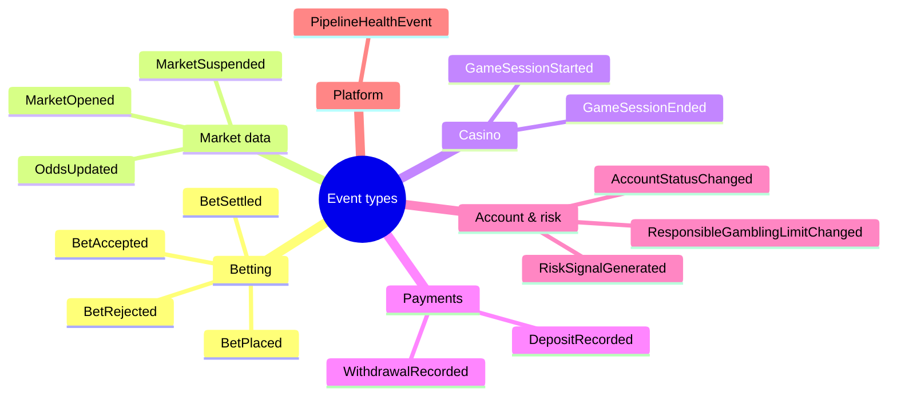
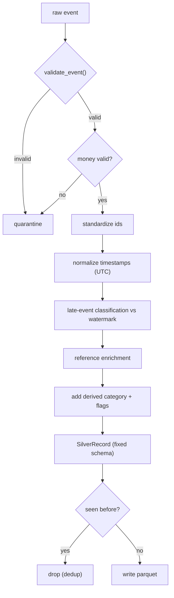
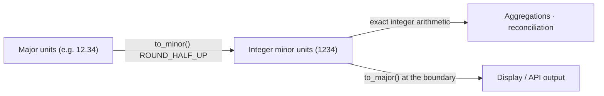
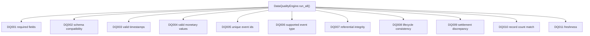
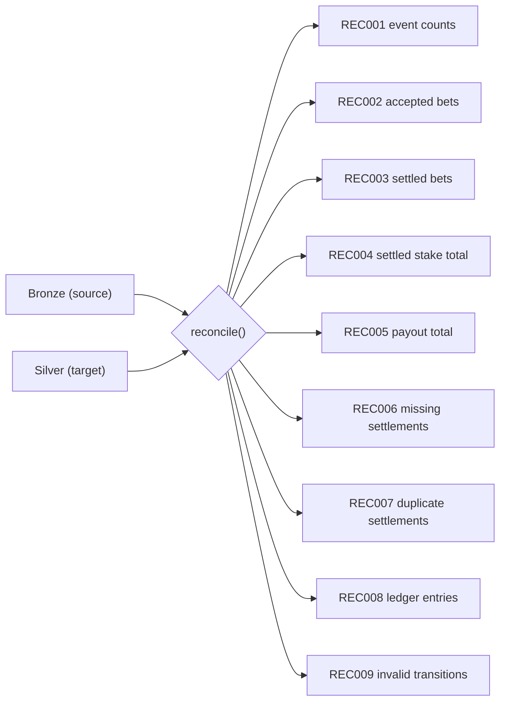
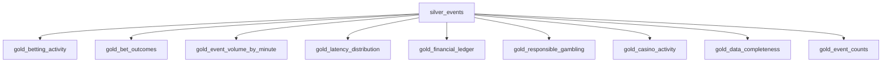
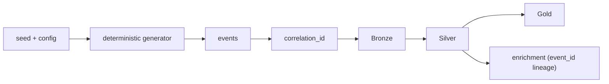

# Data engineering

This document describes the data model, the medallion layers, monetary handling,
transformation logic, data quality, reconciliation and analytics. Every claim maps
to code in `src/apexbet`.

## 1. Event model

Every event is one JSON object with a **common envelope** and a **typed payload**.



* `event_id` is the dedup key (`evt_<uuid4>`).
* `event_type` is one of **15** registered types.
* `schema_version` is policed: `1.0.0 … 1.2.0` accepted; older/newer rejected.
* Timestamps are UTC ISO-8601. Four notions of time are kept distinct:
  event-time, ingestion-time, processing-time, and (derived) processing latency.
* Monetary fields are **integer minor units** (see §4).

### The 15 event types



The canonical JSON Schemas are generated from the Pydantic models and written to
[`event-schemas.json`](./event-schemas.json) via `apexbet schemas`.

## 2. Medallion layers

```mermaid
flowchart LR
  subgraph Bronze["Bronze — raw, immutable, replayable"]
    B1["original_event_json (verbatim)"]
    B2["original_payload"]
    B3["routing + processing metadata"]
    B4["partitioned by event_type / event_date"]
  end
  subgraph Silver["Silver — clean, conformed, deduped"]
    S1["fixed, stable schema"]
    S2["normalized ids + UTC timestamps"]
    S3["reference enrichment (sport/league)"]
    S4["late-event classification"]
  end
  subgraph Gold["Gold — analytics-ready"]
    G1["9 DuckDB marts"]
    G2["DQ results"]
    G3["Reconciliation findings"]
    G4["Anomaly alerts"]
  end
  Bronze --> Silver --> Gold
```



### Storage layout (object keys)

```
bronze/event_type=<snake_case>/event_date=YYYY-MM-DD/part-<uuid>.parquet
bronze/quarantine/event_type=<...>/event_date=<...>/part-<uuid>.parquet
bronze/_parquet_failed/...            # JSONL fallback if parquet encoding fails
silver/events/event_date=YYYY-MM-DD/part-<uuid>.parquet
gold/ai_enrichment/enrich_date=YYYY-MM-DD/part-<uuid>.parquet
checkpoints/<group_id>/<topic>.json
reports/run_<run_id>.json
reports/latest.json
```

The same key layout is used by **both** storage backends (`local` filesystem and
`s3` via boto3 against LocalStack/MinIO).

## 3. Silver transformation



The transformation is a **pure function** (`silver.transform.transform_event`) so
the streaming Python processor and the Spark batch job share one implementation and
can never diverge. The Silver schema is **fixed**: optional enrichment fields are
always present (as `null` when not derivable) so every parquet file unifies cleanly.

## 4. Money handling



* All monetary values are stored and aggregated as **integer minor units**.
* `Decimal` is used only at the boundary, with `ROUND_HALF_UP`, for deterministic
  conversion. There is no floating-point drift in any total.
* Validation (`silver.transform._validate_money`) rejects non-integers, negatives
  and out-of-range magnitudes, quarantining the offending event.

## 5. Data quality (11 rules)



Each rule returns a structured `QualityResult` (rule id, dataset, severity, record
count, failure count, diagnostics, sample). Failing records are collected into a
merged quarantine list (one entry per source event, with the union of offending
rules).

## 6. Reconciliation (9 rules)



Severity is **quarantine-aware**: a difference that is fully explained by records
the pipeline deliberately quarantined or deduplicated is downgraded to `info` with
`resolution_status=EXPLAINED_BY_…`, while an unexplained difference stays
`critical`. Monetary totals (REC004/REC005) are compared **like-for-like** over the
distinct bet ids present on both sides, so quarantined or deduplicated events never
masquerade as monetary discrepancies.

## 7. Gold marts



Built by `apexbet.analytics.duckdb_engine.AnalyticsEngine.build_gold()` using DuckDB
SQL directly over the Silver parquet. An equivalent, SQL-first **dbt** project lives
under `sql/dbt` (staging → intermediate → marts); see
[`docs/data-engineering/dbt.md`](./dbt.md).

## 8. Reproducibility & lineage



* The generator is seeded (`common.rng.rng_for`) — the same seed + config yield the
  same stream, so runs and benchmarks are reproducible.
* `correlation_id` threads through related events (e.g. a bet's placed → accepted →
  settled chain).
* Enrichment records carry `event_id` and `source_dataset` for lineage back to
  Silver.
