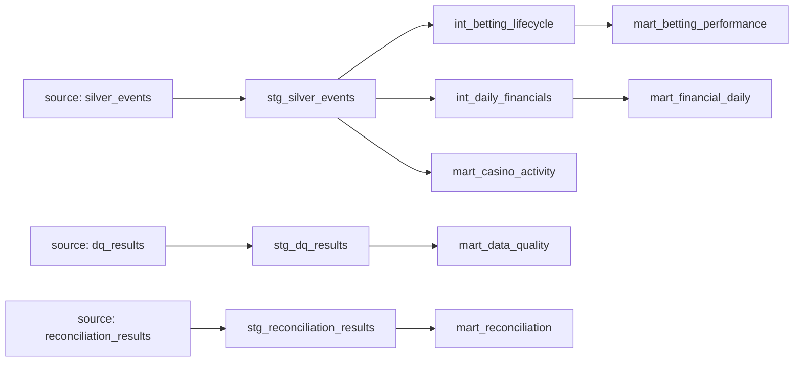

# dbt models (optional SQL-first Gold layer)

The **always-on** Gold layer is built by `apexbet.analytics.duckdb_engine`
(`apexbet analytics`). The dbt project under `sql/dbt` is the **SQL-first
alternative** a traditional analytics team would use; it reads the same
`silver_events` table and materialises curated marts.

## Lineage



| Layer | Model | Grain / purpose |
|---|---|---|
| staging | `stg_silver_events` | typed, flattened view over `silver_events` |
| staging | `stg_dq_results` | DQ rule results |
| staging | `stg_reconciliation_results` | reconciliation findings |
| intermediate | `int_betting_lifecycle` | one row per bet across placed→accepted→settled |
| intermediate | `int_daily_financials` | daily money movement per currency |
| mart | `mart_betting_performance` | betting KPIs per day × sport |
| mart | `mart_financial_daily` | net deposits, margin per day × currency |
| mart | `mart_casino_activity` | casino session KPIs per day × game |
| mart | `mart_data_quality` | latest DQ results with pass/fail + failure rate |
| mart | `mart_reconciliation` | findings with severity + ok flag |

## Running with dbt

dbt is deliberately **not** a hard dependency. To use the real dbt runtime:

```bash
pip install dbt-duckdb
mkdir -p ~/.dbt && cp sql/dbt/profiles.yml.example ~/.dbt/profiles.yml
cd sql/dbt && dbt deps && dbt run && dbt test
```

## Validating without dbt

Because `dbt-duckdb` is optional, the models are also compiled and executed by the
built-in validator, which rewrites `{{ ref(...) }}` / `{{ source(...) }}` into real
relation names and runs each model against the local DuckDB:

```bash
apexbet validate-dbt          # CLI
# or
python -m apexbet.dbt_validate
```

This runs in CI (`test` job) and in the unit test
`tests/unit/test_dbt_validate.py`, so a broken dbt model fails the build even when
`dbt-duckdb` is not installed.
