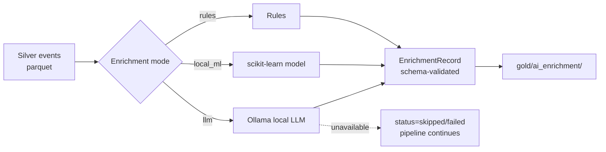
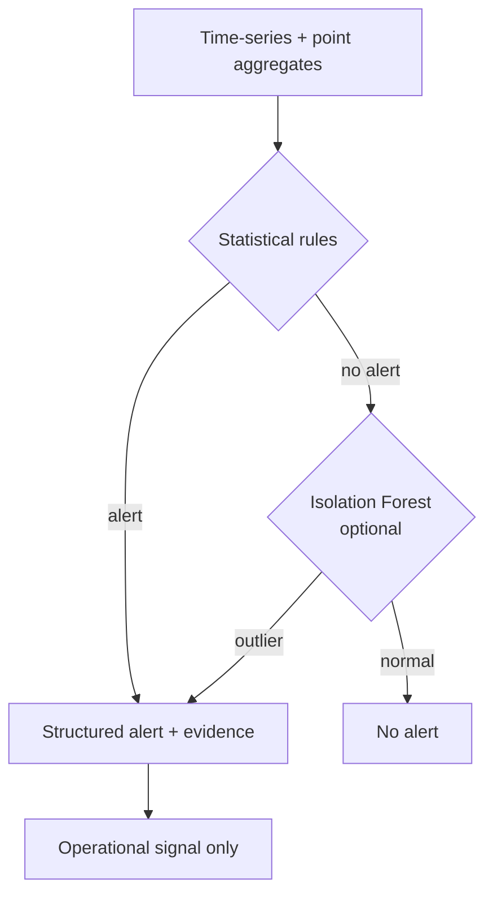

# Enrichment and Anomaly Detection

This document covers two subsystems that run over already-processed data:

1. **Enrichment** (`src/apexbet/enrichment/`) — adds derived fields (categories,
   descriptions) to cleaned Silver records.
2. **Anomaly detection** (`src/apexbet/anomaly/`) — raises alerts from aggregate
   pipeline metrics. Rules run first; an optional scikit-learn model adds a
   secondary baseline.

Both are optional add-ons. The ingestion-to-Gold pipeline runs correctly without
either of them.

## Enrichment

Enrichment is decoupled from ingestion. It reads persisted **Silver** events and
writes `EnrichmentRecord`s to a separate Gold dataset (`gold/ai_enrichment/`).
Input and output are never mixed.



### Modes

Selected via `apexbet enrich --mode {rules,local_ml,llm}` or `APEXBET_ENRICHMENT_MODE`.

| Mode | Dependency | Availability |
|------|-----------|--------------|
| `rules` (default) | none | always |
| `local_ml` | scikit-learn (a project dependency) | when a model is present |
| `llm` | local [Ollama](https://ollama.com) runtime | only when the user runs Ollama |

### Enrichment record schema

```
enrichment_id      stable content hash of (event_id, type, payload, model)
event_id           foreign key back to the source Silver event
model_name         e.g. "rules", "tfidf-nb", "llama3"
model_version      version / tag
enrichment_type    one of:
                     normalized_description
                     category_explanation
                     quality_issue_description
                     anomaly_explanation
                     incident_summary
                     remediation_suggestion
enrichment_payload free-form JSON (validated at the outer level)
confidence         0.0–1.0 or null
created_at         ISO-8601 UTC
processing_status  success | failed | skipped
error_reason       populated on failure
prompt_version     for LLM mode, so prompts are versioned
```

### LLM mode

The LLM path calls a **local Ollama** server (default `http://localhost:11434`),
configured with `APEXBET_LLM_BASE_URL`, `APEXBET_LLM_MODEL`, and
`APEXBET_LLM_TIMEOUT_SECONDS`. If Ollama is not running:

- The enricher records `processing_status = "skipped"` with an `error_reason`.
- The pipeline does not fail; rules-based enrichment is unaffected.
- No external AI API key is required or referenced.

**Limitation:** LLM output is validated structurally against the record schema,
but it is not graded for factual correctness at runtime. Treat LLM-produced
fields as provisional and review them before relying on them downstream.

## Anomaly detection

Two layers, applied in order:



### Layer 1 — rules (always on)

Threshold and z-score rules over aggregate metrics, covering traffic
spikes/drops, rejection-rate spikes, latency spikes, duplicate spikes, DQ
degradation, reconciliation discrepancies, suspicious transaction patterns,
enrichment failures, and consumer-lag growth. Each rule emits an `AnomalyAlert`
with:

```
detector, severity (info|warning|error|critical), metric,
observed, expected, threshold, explanation, evidence{}, detected_at, method="rule"
```

A relative standard-deviation floor (1% of the mean) prevents a near-constant
baseline from producing a meaningless astronomical z-score.

### Layer 2 — Isolation Forest (optional)

A scikit-learn `IsolationForest` provides a multivariate point-anomaly baseline.
It is optional: if scikit-learn is unavailable the detector runs rules-only, and
every ML-produced alert is tagged `method="isolation_forest"` so its provenance
is explicit.

Alerts are operational signals for triage. They are not attached to an account
as an accusation and do not gate a financial action.

## Evaluation harness

`apexbet anomaly-eval` runs a fixed, seeded, offline evaluation over four
labelled scenarios and prints precision/recall per scenario.

| Scenario | Injected | Expected detector(s) |
|----------|----------|---------------------|
| `volume_spike` | fan-out burst | traffic-spike rule |
| `volume_drop` | traffic collapse | traffic-drop rule |
| `rejection_spike` | ingestion rejects | rejection-rate rule |
| `duplicate_spike` | duplicate replay | dedup-spike rule |

Run it yourself:

```bash
APEXBET_TRANSPORT=memory .venv/bin/apexbet anomaly-eval
```

The harness reports measured precision/recall for the injected scenarios only.
It validates that the known detectors fire on known, controlled anomalies; it is
not a general accuracy claim. A full precision/recall over real, unlabelled
traffic is out of scope for a synthetic local platform.

## In the code

| Concern | File |
|---------|------|
| Enrichment modes / schema | `src/apexbet/enrichment/enricher.py` |
| Anomaly rules + Isolation Forest | `src/apexbet/anomaly/detector.py` |
| Evaluation scenarios + metrics | `src/apexbet/anomaly/evaluation.py` |
| CLI entry points | `src/apexbet/cli/main.py` (`enrich`, `anomaly`, `anomaly-eval`) |
