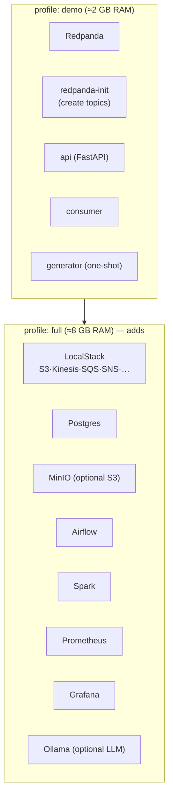
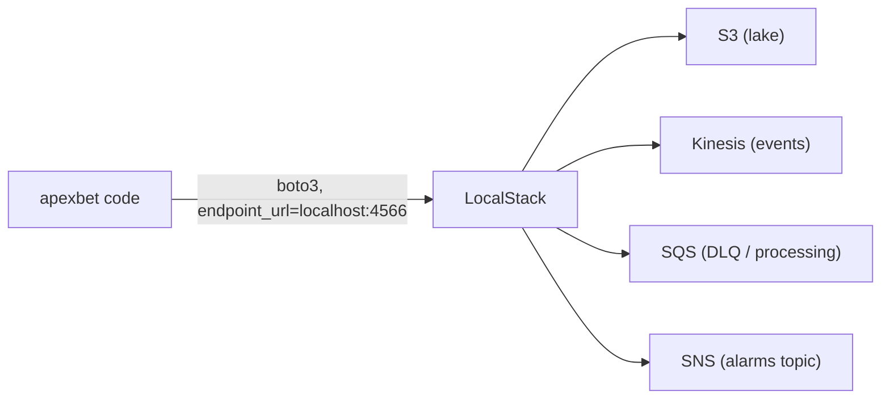
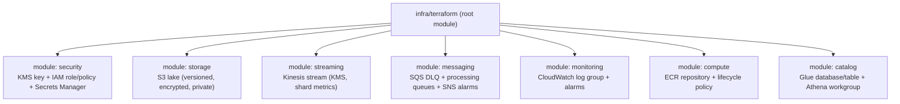
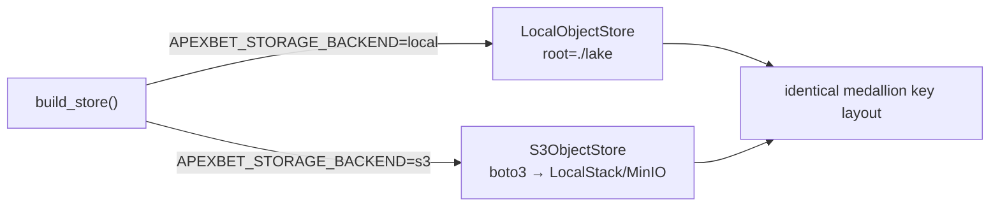

# Infrastructure

Everything runs locally with Docker Compose. There are **two profiles**: `demo`
(minimum end-to-end) and `full` (adds AWS emulation, orchestration, observability
and an optional local LLM). Terraform describes an *optional* real-AWS deployment
that is **validated only** — never applied automatically.

## 1. Compose profiles



| Service | Profile | Purpose | Port |
|---|---|---|---|
| `redpanda` | demo, full | Kafka-compatible broker | 19092, 9644 |
| `api` | demo, full | Ingestion + read API | 8000 |
| `consumer` | demo, full | Streaming Bronze/Silver processor | — |
| `localstack` | full | AWS emulation (S3, Kinesis, SQS, …) | 4566 |
| `postgres` | full | Airflow metadata DB (+ general SQL) | 5432 |
| `minio` | full | S3-compatible alternative store | 9000/9001 |
| `airflow` | full | Orchestration (4 DAGs) | 8080 |
| `spark` | full | Batch / structured-streaming jobs | 8081, 7077 |
| `prometheus` | full | Metrics scrape + alert rules | 9090 |
| `grafana` | full | Dashboards | 3000 |
| `ollama` | full | Optional local LLM (no model auto-pulled) | 11434 |

```bash
docker compose --profile demo up -d --build     # minimum
docker compose --profile full up -d --build     # everything
docker compose --profile demo --profile full down
```

Both files are validated in CI with `docker compose config`.

## 2. LocalStack (AWS emulation)



* The **community (free) edition** is targeted. Services that require a paid plan
  are documented as such and are never hard dependencies.
* The platform uses LocalStack only when `APEXBET_TRANSPORT=kinesis` (streaming) or
  `APEXBET_STORAGE_BACKEND=s3` (lake), combined with `APEXBET_USE_REAL_AWS=0`.
* Switching to real AWS is opt-in via `APEXBET_USE_REAL_AWS=1` and real credentials.

## 3. Terraform (optional AWS deployment)



* **24 resources** across 7 modules, defined in 12 `.tf` files.
* Security defaults: KMS encryption everywhere, private S3 (public access blocked),
  versioning + lifecycle, least-privilege IAM.
* Validation only — never applied by the tooling here:

```bash
# With the terraform binary (as used in CI):
terraform -chdir=infra/terraform init -backend=false
terraform -chdir=infra/terraform validate

# Without the binary (this repo's fallback, honest about what it does):
apexbet terraform-validate            # or: make terraform-validate
```

When the `terraform` binary is absent, `apexbet.infra_validate` parses every `.tf`
file with the HCL2 parser and checks structure (modules/resources/variables/
providers). The report clearly states which path was used
(`validated_with: "hcl2 parser (terraform binary unavailable)"`).

The HCL2 parser (`python-hcl2`) is an optional extra, since it is only needed for
this fallback:

```bash
uv pip install -e ".[infra]"          # or: pip install python-hcl2
```

If neither the `terraform` binary nor `python-hcl2` is present, validation reports
`ok: false` with `validated_with: "none (...)"` rather than failing — it never
claims a validation it did not perform.

## 4. Storage backends



One interface, two backends. The `local` backend needs zero dependency and powers
the offline demo; the `s3` backend shares the exact same key layout.

## 5. Resource sizing (honest numbers)

| Profile | Services | Approx. RAM | Notes |
|---|---|---|---|
| `demo` | 5 | ~2 GB | comfortable on any modern laptop |
| `full` | 12+ | ~8 GB | Airflow + Spark + LocalStack are heavy |
| `full` without Ollama/Spark | 10 | ~5 GB | disable services you don't need |

No large datasets or models are downloaded automatically. The Ollama model must be
pulled explicitly (`docker exec -it <ollama> ollama pull llama3.2:3b`).
