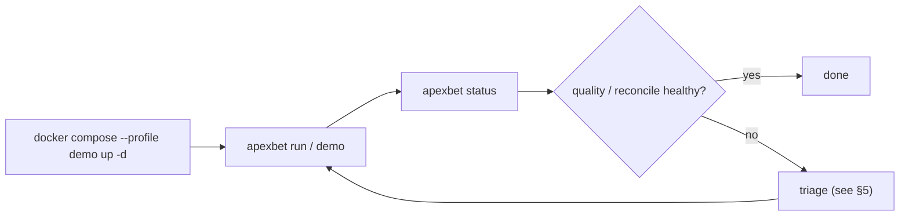
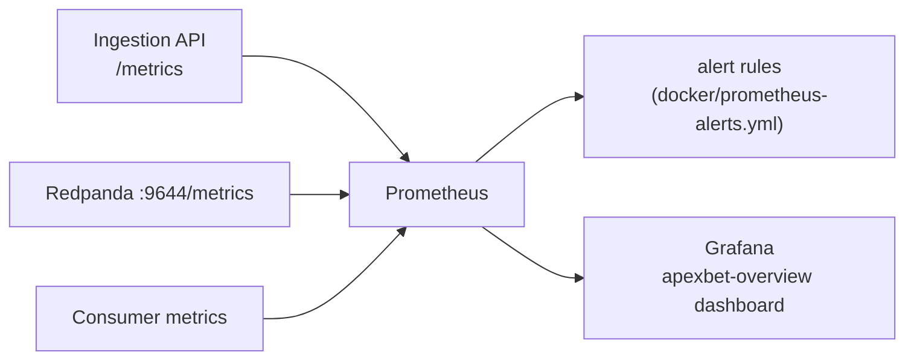
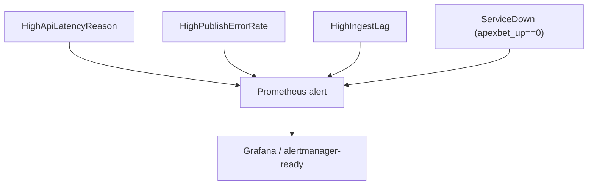
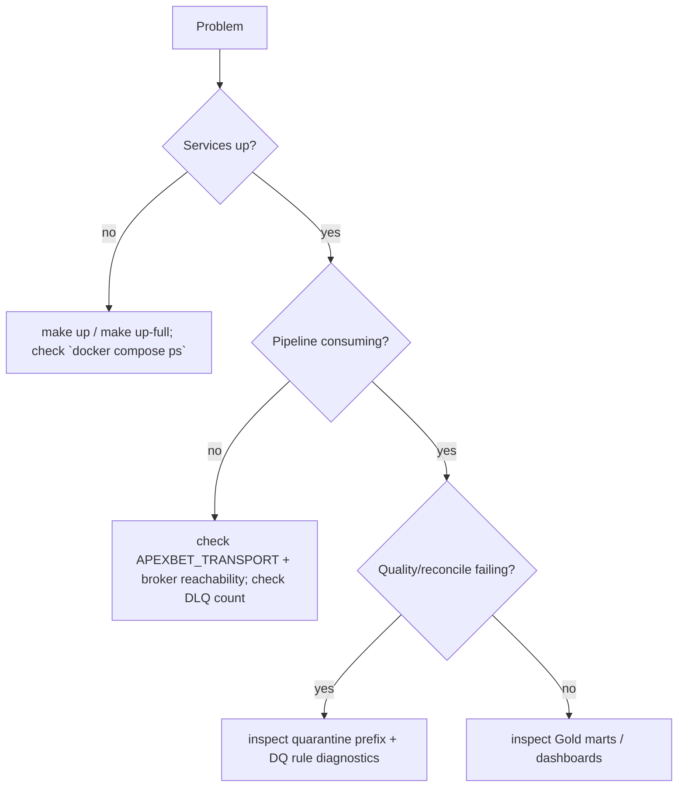

# Operations

How to run, observe and troubleshoot ApexBet. Everything here is offline-first:
the platform runs with no external service, and observability is provided by
Prometheus + Grafana in the `full` profile.

## 1. Daily operating loop

| Task | Command |
|---|---|
| Start minimum stack | `make up` |
| Start full stack | `make up-full` |
| One-shot full pipeline | `make run` |
| End-to-end demo | `make demo` |
| Health | `apexbet status` |
| Tail logs | `make logs` |
| Stop (keep volumes) | `make down` |
| Stop + wipe | `make down-clean` |

## 2. Observability

### API metrics exposed

| Metric | Type | Meaning |
|---|---|---|
| `apexbet_api_requests_total{endpoint,status}` | counter | requests by endpoint + HTTP status |
| `apexbet_api_request_latency_seconds{endpoint}` | histogram | API latency |
| `apexbet_events_published_total{event_type}` | counter | events accepted + published |
| `apexbet_events_rejected_total{reason}` | counter | events rejected at validation |
| `apexbet_publish_errors_total` | counter | transport publish failures |
| `apexbet_ingest_lag_seconds` | histogram | event-time → ingestion lag |
| `apexbet_up` | gauge | 1 while the service is up |

Label cardinality is deliberately bounded — **no ids are used as labels**.

### Alert rules (illustrative thresholds)

## 3. Backup & retention

* The **lake is the source of truth** for processed data. Bronze is immutable and
  replayable — it is your backup foundation.
* With the `s3` backend, S3 versioning + lifecycle are configured by the Terraform
  storage module (provisioned in a real deployment).
* Checkpoints live at `checkpoints/<group_id>/<topic>.json`; deleting them forces a
  full replay from the broker's earliest offset.

## 4. Scaling notes (honest, local)

* The single-process consumer is the throughput ceiling locally. Measured
  single-process throughput is in the low thousands of events/second on a laptop —
  see [`../testing/benchmarks.md`](../testing/benchmarks.md). This is **not** a
  production capacity claim.
* Horizontal scaling levers that the design supports (documented, not benchmarked
  here): more consumer instances in the same group (Kafka), more shards (Kinesis),
  and the Spark batch path for large Silver→Gold rebuilds.

## 5. Troubleshooting runbook

| Symptom | Likely cause | Action |
|---|---|---|
| `TransportError: unknown transport` | bad `APEXBET_TRANSPORT` | set to `memory`/`redpanda`/`kinesis` |
| No events consumed | broker not reachable / wrong group offset | check `apexbet status`; verify topic exists |
| `dlq` rising | malformed JSON at the source | inspect `apexbet.events.dlq.v1` |
| `quarantined` rising | invalid payloads (money/schema/refs) | inspect `bronze/quarantine/*` |
| REC004/REC005 non-zero | genuine monetary mismatch | compare Bronze vs Silver for the bet ids listed |
| `_parquet_failed/*` exists | parquet encoding failure | records preserved as JSONL; re-encode |

## 6. Cost

Local operation costs **$0**: only open-source software and LocalStack community
edition. No cloud resource is created or destroyed by this repository's tooling.
The optional Terraform is for documentation/validation only.
