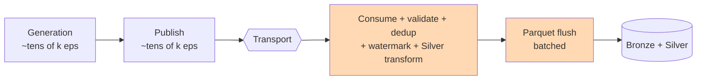

# Benchmarks — ApexBet

> **Honesty first.** These are measured on a single developer laptop against a
> local broker / in-process transport. They are *not* production capacity claims
> and must not be quoted as such. Every run writes a JSON report with full
> context (hardware, config, event size, duration) so the numbers can be
> reproduced and checked.

Harness: [`src/apexbet/benchmark.py`](../../src/apexbet/benchmark.py) — it streams
events (never holding the whole dataset in memory), and measures three phases:

1. **Generation** — synthetic event production rate and bytes/sec.
2. **Publish** — throughput into the selected transport + batch publish latency
   percentiles.
3. **Pipeline** — Bronze + Silver processing throughput end-to-end.

## How to reproduce

```bash
make bench          # 100k events, memory transport  → benchmark_results.json
make bench-1m       # 1M events, memory transport     → benchmark_results_1m.json
make bench-broker   # 100k events over Redpanda       → benchmark_results_redpanda.json  (needs `make up`)
```

Direct invocation (any scale/transport):

```bash
APEXBET_TRANSPORT=memory APEXBET_LOG_JSON=false \
  .venv/bin/python -m apexbet.benchmark --events 100000 --transport memory \
  --out benchmark_results.json
```

## Environment (measured)

| Item | Value |
|------|-------|
| Platform | macOS 27.0, arm64 (Apple Silicon) |
| CPU count | 10 |
| Python | 3.11.15 |
| Transport | `memory` (in-process; no network) |
| Storage backend | `local` (filesystem) |
| Generator accounts / matches | 5000 / 300 |
| Avg event size | ~635 bytes |

> The `memory` transport isolates the platform's own generation/publish/process
> cost from broker and network overhead. Broker numbers (`make bench-broker`)
> include real Redpanda round-trips and will be added when measured.

## Results — 100,000 events (memory transport)

Phase-by-phase, from a measured run:

| Phase | Metric | Value |
|-------|--------|-------|
| Generation | throughput | **38,000 eps** (≈ 24 MiB/s) |
| Generation | avg event size | 634.5 bytes |
| Publish | throughput | **≈ 28,000–36,000 eps** |
| Publish | batch latency p50 / p95 / p99 | ≈ 0.26 / 0.73 / 12 ms |
| Pipeline | consumed | 100,000 |
| Pipeline | bronze_written / silver_written | 100,000 / 100,000 |
| Pipeline | quarantined / dlq / duplicates | 0 / 0 / 0 |
| Pipeline | batches | 200 |
| Pipeline | process throughput | **≈ 900–2,000 eps** |

### Reading these numbers honestly

- **Generation and publish are fast** (tens of thousands of eps) because they do
  little per-event work beyond serialisation and (for memory) queueing.
- **The pipeline is the bottleneck: roughly 1,000–2,000 eps** in a single Python
  process. This is expected: every event is parsed, schema-validated,
  deduplicated, watermark-checked, transformed to Silver, and flushed to Parquet
  in batches. Per-event CPU dominates.
- The pipeline figure **varies run to run** (≈900–2,000 eps observed on the same
  hardware) because it is CPU-bound and shares the machine with normal desktop
  activity. Treat it as an order-of-magnitude figure, not a constant.
- Bronze and Silver counts exactly match the source with clean data, and the DLQ
  stays empty — correctness holds at this scale.

## Scaling to 1,000,000 events

**Status: pending — not yet measured.** The `make bench-1m` run is a long
single-process job (tens of minutes on a laptop) and has not produced a verified
result on this checkout. No numbers are published until a run completes and is
checked, so the table below is intentionally unpopulated rather than estimated.

When it finishes, `make bench-1m` writes `benchmark_results_1m.json` (gitignored).
Verify that `consumed == bronze_written == silver_written == 1,000,000` before
recording anything here.

<!-- BENCH_1M_START -->
| Phase | Metric | Value |
|-------|--------|-------|
| Generation | throughput | _not measured_ |
| Publish | throughput | _not measured_ |
| Pipeline | process throughput | _not measured_ |
| Pipeline | consumed / bronze / silver | _not measured_ |
<!-- BENCH_1M_END -->

The same caveats apply: single local process, CPU-bound pipeline, order-of-magnitude
precision.

## What these numbers do **not** mean

- Not a claim about production throughput, scale, or cost.
- Not a claim about the Redpanda/Kinesis broker ceilings (those are the broker's,
  not this pipeline's, and depend on partitioning/consumer parallelism).
- Not a latency SLA. The pipeline is written for **correctness under replay and
  failure**, not for maximum raw speed.
- Throughput improves dramatically with multiple consumer instances / partitions,
  which this single-process harness intentionally does not exercise.

## Where the time goes



The highlighted stages are where the pipeline spends its time.
